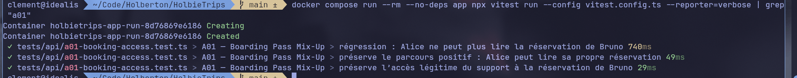

# A01 - Boarding Pass Mix-Up

## Vulnerability

When logged in as Alice, it's possible to make a GET for a booking/id that doesn't belong to Alice.

## Exploitation

- Open Devtools in Network tab
- Open the demo booking belonging to Alice
- Right click on the request -> Edit and Resend
- Increment the booking ID from the request URL by 1 (now ends in 2) to match Bruno's booking
- Resend the request and inspect response for flag.

## Root Cause

`GET /api/bookings/:id` (`apps/api/src/routes/bookings.ts`) fetched the booking directly by its ID and returned it to any authenticated user, without ever checking that the booking belonged to the caller. The handler already distinguished owner vs. non-owner (it appended the flag to `itinerary_notes` for non-owners), proving the information was available, but it was never used to deny access — only to decorate the leaked response. This is a Broken Access Control / IDOR flaw: authentication verifies *who* the user is, but the missing authorization check never verifies they are allowed to see *this* resource.

A reusable ownership check, `canReadBooking(user, ownerId)` in `apps/api/src/domain.ts`, already existed and was covered by unit tests in `tests/api/business.test.ts`, but it was never wired into the route.

## Remediation

`GET /api/bookings/:id` now calls `canReadBooking(request.authUser, booking.user_id)` after loading the booking, and returns `404` ("Réservation introuvable") when the caller is neither the booking's owner nor a support user, instead of returning the record. This closes the IDOR: Alice can no longer read Bruno's booking by incrementing the ID in the URL, while she can still read her own, and support staff retain legitimate cross-account access for customer service.

The characterization test in `tests/api/a01-booking-access.test.ts` was converted into a regression test asserting the `404` response and the absence of the challenge flag in the body, while the existing positive test (Alice reading her own booking) was preserved unchanged. A new test was added covering the previously-untested support path at the HTTP level: a support-role session can still read Bruno's booking (`200`), confirming the fix denies cross-account access without breaking legitimate support lookups.

## Verification

