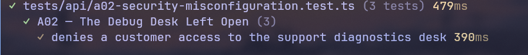

# A02 - The Debug Desk Left Open

## Vulnerability

Every API response carries an `x-holbietrips-debug-desk: /api/support/diagnostics` header, advertising a diagnostics endpoint meant only for support staff. That endpoint is reachable by **any authenticated user**, not just support — it returns runtime info, the internal service map, and the challenge flag. A logged-in customer (e.g. Alice) can read staff-only operational data and the flag simply by following the leaked header.

## Exploitation

- Open Devtools → Network tab while logged in as a regular customer (e.g. Alice).
- Inspect the response headers of any API request (e.g. `GET /api/trips`) and note `x-holbietrips-debug-desk: /api/support/diagnostics`.
- Send `GET /api/support/diagnostics` with the customer's own session `Authorization: Bearer <token>` header (reuse an existing request via "Edit and Resend", changing only the URL).
- The response is `200 OK` with `intendedAudience: "support"` and the flag, even though the caller's role is `customer`.

## Root Cause

`GET /api/support/diagnostics` (`apps/api/src/routes/system.ts`) is registered with `{ preHandler: context.requireUser }`, which only checks that *some* session is authenticated — it never checks the caller's `role`. Every other support-only route in the codebase (`PATCH /api/support/tickets/:id`, `GET /api/audit` in `apps/api/src/routes/support.ts`) uses `context.requireRole('support')` instead, so this route is the one inconsistent case: a Security Misconfiguration where a sensitive, staff-only endpoint was wired up with the generic "logged in" guard rather than the staff role guard that already existed and is used elsewhere. The leaked `x-holbietrips-debug-desk` response header (`apps/api/src/app.ts`) then makes the endpoint trivially discoverable to any client.

## Remediation (suggested — not yet applied)

- Change the preHandler on `GET /api/support/diagnostics` from `context.requireUser` to `context.requireRole('support')`, matching the pattern already used for `/api/audit` and `/api/support/tickets/:id`. This keeps the endpoint available to support staff while returning `403` for any authenticated non-support caller (and `401` for anonymous callers).
- Update the characterization test in `tests/api/a02-security-misconfiguration.test.ts` so the first case asserts `403` for the customer instead of `200` with the flag, once the role check is added.

## Verification

