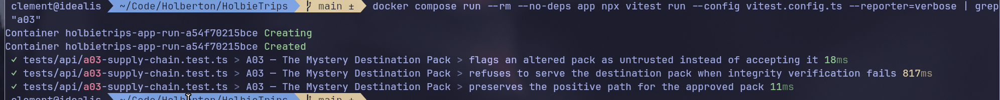

# A03 - The Mystery Destination Pack

## Vulnerability

The API serves a third-party "destination pack" (supplier-provided travel content merged into `/api/destination-pack` and `/api/trips`) after computing a SHA-256 digest of the file and comparing it against the approved digest — but the integrity check never actually gates anything. A pack whose digest does not match the approved one is still served to every caller, meaning tampered supplier content is trusted and distributed unmodified. By default the API is even configured to load the tampered fixture (`database/fixtures/destination-pack-altered.json`) instead of the approved one.

## Exploitation

- Call `GET /api/destination-pack` against a default deployment (no env overrides).
- The response is `200 OK` and contains the destination pack's content, including the flag planted in the tampered `kyoto-saisons` travel tip — proof the altered file was accepted and served even though its digest does not match `DESTINATION_PACK_SHA256`.
- `GET /api/trips` also surfaces the tampered `travel_tip` values, since it reuses the same unverified pack internally.

## Root Cause

`loadDestinationPack()` (`apps/api/src/destination-pack.ts`) computed `calculatedSha256` and compared it to `expectedSha256`, but hard-coded `integrity.accepted` to `true` regardless of the comparison result — a Software/Data Integrity Failure where the verification step was performed but its outcome was never enforced. `getDestinationPack()` in `apps/api/src/routes/catalog.ts` then unconditionally returned the loaded pack to callers with no check on `integrity.accepted` at all. On top of that, `DESTINATION_PACK_FILE` defaulted (in `apps/api/src/config.ts`, `.env.example`, and `compose.yaml`) to the altered fixture rather than the approved one, so an out-of-the-box deployment served unverified data by default.

## Remediation

- `loadDestinationPack()` (`apps/api/src/destination-pack.ts`) now sets `integrity.accepted = (calculatedSha256 === expectedSha256)`, so the flag correctly reflects whether the file matches the approved digest.
- `getDestinationPack()` (`apps/api/src/routes/catalog.ts`) now throws when `integrity.accepted` is `false`; both `GET /api/destination-pack` and `GET /api/trips` catch this and respond `503` instead of serving unverified supplier data.
- `DESTINATION_PACK_FILE` now defaults to the approved pack (`apps/api/src/config.ts`, `.env.example`, `compose.yaml`) instead of the altered fixture.
- The characterization test in `tests/api/a03-supply-chain.test.ts` was converted into a regression test: the altered pack is now correctly flagged as untrusted (`accepted: false`) and the route returns `503` with no flag leak and no pack content (`destinations` absent, altered travel tip text absent from the body), while the approved pack still loads and reports `accepted: true` normally.

## Verification

