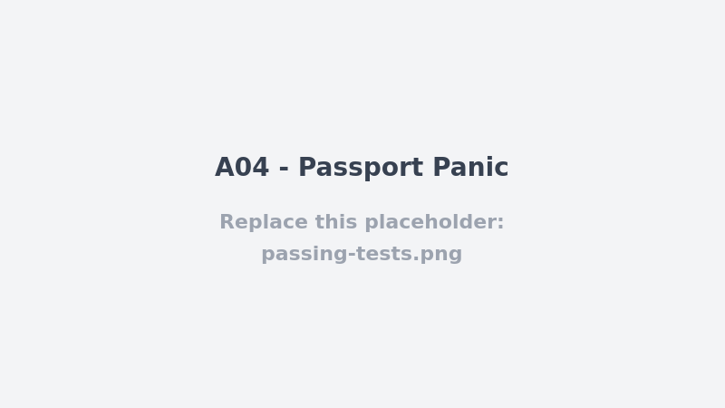

# A04 - Passport Panic

## Vulnerability

TODO: Brief description of the observed behaviour and its impact.

## Exploitation

TODO: Steps used to reproduce the issue locally.

## Root Cause

TODO: Explanation of the vulnerable code or missing security control.

## Remediation

TODO: Summary of the implemented correction.

## Verification

