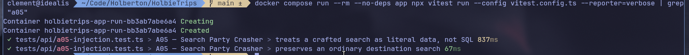

# A05 - Search Party Crasher

## Vulnerability

`GET /api/trips` builds its SQL `WHERE` filter by interpolating the raw `q` query parameter directly into the query string, in `apps/api/src/routes/catalog.ts`. The handler blocks `;` to stop stacked statements, but that guard does nothing against a boolean-based injection: the same `q` value is substituted **three times** (into the `title`, `destination`, and `description` `ILIKE` clauses), and a single crafted value can close the quoted string literal, inject `OR 1=1` into the `WHERE` clause, then use an SQL line comment (`--`) to swallow the two remaining copies of the payload plus the stray closing parenthesis. Because SQL evaluates `AND` before `OR`, the resulting predicate `is_published=true AND (...) OR 1=1` is true for every row regardless of `is_published`. Any unauthenticated visitor can use the public search box to read trips that are not published — including the `archive-search-party` trip, whose description carries the challenge flag.

## Exploitation

- Send an unauthenticated `GET` request to the public search endpoint with a crafted `q`:
  ```
  GET /api/trips?q=x') OR 1=1--
  ```
  URL-encoded: `GET /api/trips?q=x%27)%20OR%201%3D1--`
- The payload is 12 characters, well under the 100-character cap applied by `readText`, and contains no `;`, so it passes the existing guard untouched.
- The response is `200 OK` and its `trips` array now includes rows with `is_published=false`, including `archive-search-party`, whose `description` field contains the flag.

## Root Cause

```ts
const query = readText((request.query as RequestBody).q, 100);
if (query.includes(';')) {
  return reply.code(400).send({ error: 'Une seule recherche est autorisée' });
}

const filter = query
  ? ` AND (title ILIKE '%${query}%' OR destination ILIKE '%${query}%' OR description ILIKE '%${query}%')`
  : '';
const result = await pool.query(
  `SELECT id,slug,title,destination,description,departure_date,return_date,price_cents,seats_available,image_key
   FROM trips
   WHERE is_published=true${filter}
   ORDER BY departure_date`
);
```

`filter` is built with raw string interpolation rather than a parameterized query, and `query` appears three separate times inside it. With `q = x') OR 1=1--`, `filter` expands to:

```sql
 AND (title ILIKE '%x') OR 1=1--%' OR destination ILIKE '%x') OR 1=1--%' OR description ILIKE '%x') OR 1=1--%')
```

The `'%x')` closes both the string literal and the `(...)` group opened right after `is_published=true AND`, turning `OR 1=1` into a top-level condition on the `WHERE` clause. The trailing `--` is a Postgres line comment: everything after it on that source line — the two remaining copies of the payload and the stray `)` — is discarded, while `ORDER BY departure_date` on the next line is untouched and keeps the statement syntactically valid. The effective query the database executes is:

```sql
SELECT id,slug,title,destination,description,departure_date,return_date,price_cents,seats_available,image_key
FROM trips
WHERE is_published=true AND (title ILIKE '%x') OR 1=1
ORDER BY departure_date
```

This is a classic SQL Injection (CWE-89): the `;` check only defends against stacked queries, not against boolean/comment-based manipulation of an existing `WHERE` clause reached through string concatenation.

## Remediation

- `GET /api/trips` (`apps/api/src/routes/catalog.ts`) now separates the SQL text from the search value, matching the parameterized-query convention already used by every other route (`bookings.ts`, `auth.ts`, `profile.ts`, `support.ts`, `payments.ts`): the filter clause uses a `$1` placeholder (`ILIKE $1`, reused for all three columns) and the `%`-wrapped search term is passed as a separate `values` array to `pool.query`, instead of being concatenated into the query string.
  ```ts
  const filter = query ? ' AND (title ILIKE $1 OR destination ILIKE $1 OR description ILIKE $1)' : '';
  const values = query ? [`%${query}%`] : [];
  const result = await pool.query(
    `SELECT ... FROM trips WHERE is_published=true${filter} ORDER BY departure_date`,
    values
  );
  ```
  The database driver now binds `values[0]` as a literal string value for the `ILIKE` comparison — it can never be interpreted as SQL syntax, so closing quotes, `OR 1=1`, and `--` comments in `q` are all treated as ordinary search text with no matches, rather than altering the query's structure.
- The now-redundant `query.includes(';')` guard was removed: it only ever blocked stacked statements, a narrower attack this fix already closes by construction, and it added no protection against the boolean/comment-based bypass described above.
- The characterization test in `tests/api/a05-injection.test.ts` was converted into a regression test: sending `q=x') OR 1=1--` now returns `200` with no flag in the body, and the test asserts the SQL text sent to the driver never contains `1=1` while the bound value is exactly the literal, unmodified search pattern. The existing ordinary-search test (`q=Kyoto` still matches published trips) was preserved unchanged.

## Verification


