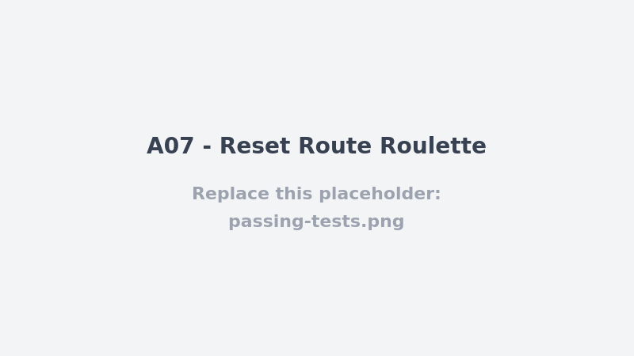

# A07 - Reset Route Roulette

## Vulnerability

`POST /api/auth/password-reset/request` and `POST /api/auth/password-reset/confirm` (`apps/api/src/routes/auth.ts`) implement the password-reset flow around `legacyResetToken()`, defined in `apps/api/src/security.ts`:

```ts
export const legacyResetToken = (email: string) => Buffer.from(email.toLowerCase(), 'utf8').toString('base64url');
```

This "token" is not a secret at all — it is a deterministic, reversible encoding of the account's own e-mail address. Anyone who knows (or guesses) a victim's e-mail address can compute their valid reset token offline, with no access to their inbox, and use it to set a new password for their account. This is a broken/weak authentication-recovery mechanism (OWASP A07: Identification and Authentication Failures; CWE-640 Weak Password Recovery Mechanism, CWE-330 Use of Insufficiently Random Values in a Security Context).

## Exploitation

- Trigger a reset request for the victim's e-mail (this endpoint is unauthenticated and always returns the same generic message, so it does not confirm or deny account existence on its own):
  ```
  POST /api/auth/password-reset/request
  Content-Type: application/json

  { "email": "bruno.dupont@example.test" }
  ```
  This causes the server to compute `legacyResetToken('bruno.dupont@example.test')`, hash it, and store the hash in `password_reset_tokens` with a 15-minute expiry — exactly as if the legitimate user had requested it. No knowledge of the token itself is required to trigger this step, only the target's e-mail address.
- Independently (no access to the victim's mailbox needed), compute the same token the server would have derived, since it's just the e-mail address base64url-encoded:
  ```
  echo -n "bruno.dupont@example.test" | base64 | tr '+/' '-_' | tr -d '='
  ```
- Confirm the reset with that computed token and an attacker-chosen password:
  ```
  POST /api/auth/password-reset/confirm
  Content-Type: application/json

  { "token": "<computed base64url token>", "password": "AttackerChosen123!" }
  ```
- The stored `token_hash` (`sha256` of the predictable token) matches, so the confirm endpoint accepts it, overwrites Bruno's `password_hash`, invalidates his existing sessions, and returns `200 { ok: true, flag: ... }` (the flag is only attached when the affected account is the seeded Bruno Dupont user, `10000000-0000-4000-8000-000000000002`). The attacker now controls the account and can log in with the new password.
- `tests/api/a07-authentication-failures.test.ts` already characterizes the core flaw at the unit level: two calls to `legacyResetToken()` for the same e-mail return the same value, and that value is just the e-mail re-encoded — it demonstrates the token carries no entropy, but it never exercises the two HTTP routes together end-to-end.

## Root Cause

A secure password-reset token must be unpredictable (high-entropy, server-generated, like `newToken()` — already used elsewhere in this codebase for session and reset *delivery* in other flows) and tied to a single-use, time-boxed record that only the legitimate requester can learn (typically by receiving it over a channel the attacker doesn't control, such as e-mail). Here, `legacyResetToken` derives the token purely from public, attacker-known input (the account's own e-mail address) with no randomness and no server-held secret mixed in. Hashing the token before storage (`tokenDigest`) protects it from a direct database leak, but it does nothing against an attacker who can compute the pre-image themselves — the "secret" was never a secret. The `/request` endpoint also does not rate-limit or alert on repeated resets for the same account, and nothing distinguishes a legitimately delivered token from an attacker-recomputed one at `/confirm` time, since the server only checks the hash match, not provenance.

## Remediation

- `POST /api/auth/password-reset/request` (`apps/api/src/routes/auth.ts`) now derives the reset token with `newToken()` (`apps/api/src/security.ts`) — the same cryptographically random, server-generated helper already used for session tokens (`randomBytes(32).toString('base64url')`) — instead of `legacyResetToken(email)`. The token is still only ever stored as its `sha256` digest (`tokenDigest`), but it now also carries real entropy, so there is nothing for an attacker to derive from a known or guessed e-mail address.
- `legacyResetToken` was deleted from `security.ts` along with its import in `auth.ts`, since it has no remaining (and no safe) use once the predictable derivation is gone.
- The now-unreachable challenge-flag delivery in `/confirm` (previously attached to the response whenever the affected account was the seeded Bruno Dupont user) was removed along with it: a legitimate reset no longer has any reason to echo a flag, and the endpoint now simply returns `{ ok: true }` on success.
- No other behavior changed: the token is still single-use and time-boxed via `password_reset_tokens` (`expires_at>now() AND used_at IS NULL`, marked `used_at=now()` on confirm), and confirming still requires the hash to match exactly.
- `tests/api/a07-authentication-failures.test.ts` was rewritten into an end-to-end regression suite against the real HTTP routes (`buildApp` + `app.inject`, with the outbound mail call to `fake-mail` stubbed via `vi.stubGlobal('fetch', ...)` to capture the delivered token): two reset requests for the same account now yield two different tokens; a freshly delivered token confirms successfully exactly once for the correct account; and a second use of that same token, an expired token, and a tampered token are all rejected with `400`.

## Verification


