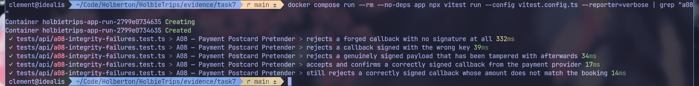

# A08 - Payment Postcard Pretender

## Vulnerability

`POST /api/payments/callback` (`apps/api/src/routes/payments.ts`) is a public, **unauthenticated** endpoint meant to receive payment-confirmation notifications from the external payment provider, but it never verifies that the request actually came from that provider. It trusts the JSON body's `status`, `amountCents`, `providerReference`, and `cardLast4` fields outright and, if they loosely line up with an existing pending booking, marks that booking `confirmed` and inserts an `approved` payment row — with no signature, no shared secret, no provider callback token, and no check that the caller is the booking's owner. This is a classic Software/Data Integrity Failure (OWASP A08: untrusted external input is deserialized/trusted without verifying its authenticity) and doubles as a Broken Access Control issue, since it lets anyone confirm (or front-run the payment for) a booking that belongs to someone else.

## Exploitation

- Identify any `pending` booking and its exact `total_cents` (e.g. the seeded Bruno Dupont booking `40000000-0000-4000-8000-000000000002`, `HT-BRUNO-001`, `129900` cents — discoverable from seed data, from a prior authenticated `GET /api/bookings`, or simply guessed/brute-forced since `amountCents` only needs to match exactly).
- Send a forged callback with no authentication and no valid signature at all:
  ```
  POST /api/payments/callback
  Content-Type: application/json

  {
    "bookingId": "40000000-0000-4000-8000-000000000002",
    "amountCents": 129900,
    "status": "approved",
    "providerReference": "FORGED-DEMO",
    "cardLast4": "4242"
  }
  ```
- The handler's only checks are shape/format validation (`isUuid`, integer amount, `status === 'approved'`, reference length, 4-digit `cardLast4`) and a DB lookup that `bookingId` exists with matching `total_cents` and `status='pending'`. None of that requires proving the payment ever happened. The response is `200 { status: 'confirmed', flag: ... }`, the booking flips to `confirmed`, and a fabricated `payments` row is written as if the card had actually been charged — all without the attacker spending a cent or even being logged in.
- Contrast with the legitimate flow at `POST /api/bookings/:id/pay`, which calls the internal payment service, receives a response, and **does** verify it with `validSignature(signedFields, payment.signature, settings.paymentKey)` (HMAC-SHA256, `apps/api/src/security.ts`) before trusting it. The callback route has no equivalent check — it skips straight to acting on the payload.
- `tests/api/a08-integrity-failures.test.ts` already characterizes this: an unsigned callback with a matching `bookingId`/`amountCents` returns `200` and the flag; a callback with a mismatched amount correctly 404s (because the amount happens to be part of the lookup `WHERE` clause), which is incidental protection, not an authenticity check.

## Root Cause

`internalJson()` (used by `/pay`) restricts *outbound* calls to the configured internal payment host, but nothing restricts who may call *inbound* into `/api/payments/callback` — it's registered without `preHandler: context.requireUser` and, more importantly, without any provider-specific trust mechanism (shared secret header, HMAC signature over the payload, mTLS, IP allowlist, etc.). The signing/verification primitives already exist in this codebase (`paymentSignature` / `validSignature`) and are correctly used for the provider's response inside `/pay`, but the webhook-style `/callback` endpoint was built to accept the same shape of payload directly from the public internet with none of that verification applied — the authenticity check was simply omitted for this entry point.

## Remediation

- `POST /api/payments/callback` (`apps/api/src/routes/payments.ts`) now requires the same authenticity proof the legitimate `/pay` flow already trusts: the caller must submit a `signature` field, and the handler recomputes the expected HMAC-SHA256 over the canonical payload (`{bookingId, amountCents, status, providerReference, cardLast4}`) with `paymentSignature(...)`/`validSignature(...)` (`apps/api/src/security.ts`) and the shared `settings.paymentKey` secret, using the existing constant-time `timingSafeEqual` comparison. A request with no signature, a signature produced with the wrong key, or a signature that no longer matches the payload (e.g. a tampered `amountCents`) is rejected with `400` *before* any lookup or write against `bookings`/`payments` — the forged-callback exploit from the report above no longer confirms anything.
- A rejected callback is now also recorded (`recordAudit(pool, null, 'payment.rejected', 'booking', bookingId, { reason: 'invalid-callback-signature' })`), so repeated forgery attempts against a given booking are visible rather than silent, mirroring the existing `payment.rejected` logging on the `/pay` path.
- A successfully verified callback now writes a `payment.approved` audit event (`source: 'callback'`) inside the same transaction as the `payments` insert and the `bookings` status update, so the booking's audit trail reflects confirmations that arrive via the asynchronous webhook path exactly as it already does for the synchronous `/pay` path.
- The now-unreachable challenge-flag delivery (previously returned to *any* caller who could satisfy the shape checks) was removed along with the fix: a legitimate, correctly signed confirmation has no reason to echo a flag, and the endpoint now simply returns `{ status: 'confirmed' }`.
- No other behavior changed: the endpoint still validates the payload's shape (`isUuid`, integer amount, `status === 'approved'`, reference length, 4-digit `cardLast4`) and still requires the referenced booking to exist, match the claimed `total_cents`, and be `pending` before it is confirmed — the new signature check is an additional, necessary layer, not a replacement for those checks.
- `tests/api/a08-integrity-failures.test.ts` was rewritten into an end-to-end regression suite against the real HTTP route (`buildApp` + `app.inject`): an unsigned forged callback, a callback signed with the wrong key, and a genuinely signed payload whose `amountCents` is altered afterwards are all rejected with `400` and never touch `payments`/`bookings`; a callback correctly signed with the shared `paymentKey` is accepted, confirms the booking, inserts the payment row, and logs `payment.approved`; and a correctly signed callback for a mismatched amount still 404s exactly as before.

## Verification


