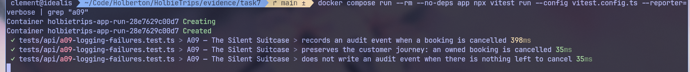

# A09 - The Silent Suitcase

## Vulnerability

`POST /api/bookings/:id/cancel` (`apps/api/src/routes/bookings.ts`) lets an authenticated customer cancel their own pending/confirmed booking, and it succeeds correctly — but the action leaves **no audit trail whatsoever**. Every other state-changing, security-relevant action in this codebase (`auth.register`, `auth.login`, `auth.logout`, `auth.password_reset_requested`, `auth.password_reset_completed`, `booking.created`, `payment.approved`, `payment.rejected`, `payment.failed`, …) calls `recordAudit(...)` to write a row into `audit_events`. Booking cancellation is the one mutating endpoint that doesn't. This is a Security Logging and Monitoring Failure (OWASP A09): a customer-facing action that changes booking status (and, downstream, seat inventory and any refund/payment workflow) can be performed — repeatedly, by anyone, against any of their own bookings — without producing any record that could be used to detect abuse, reconstruct a timeline during an incident, or attribute who cancelled what and when.

## Exploitation

- Authenticate as any customer and cancel one of their own bookings:
  ```
  POST /api/bookings/40000000-0000-4000-8000-000000000001/cancel
  Authorization: Bearer <token>
  ```
- The handler runs a single `UPDATE bookings SET status='cancelled' WHERE id=$1 AND user_id=$2 AND status<>'cancelled' RETURNING id,reference,status` and, on success, returns `200 { booking: {...}, flag: ... }`. No query against `audit_events` is ever issued for this request — the booking's cancellation is invisible to anything that relies on the audit log (security dashboards, incident response, abuse/fraud detection, customer-support history).
- `tests/api/a09-logging-failures.test.ts` already characterizes this directly: it asserts the cancel call returns `200` with the flag while also asserting that none of the queries executed against the fake pool include `INSERT INTO audit_events`.
- Practical impact: this isn't just a compliance gap. Because cancellation is silent, it can be abused for griefing (repeatedly cancelling bookings to free seats/trigger notifications) or fraud (cancel-then-dispute-refund patterns) with no server-side record to detect the pattern or correlate it with other events for the same user/booking — compare with `payment.rejected`/`payment.failed`, which *are* logged specifically so that kind of abuse is traceable.

## Root Cause

`registerBookingRoutes` in `apps/api/src/routes/bookings.ts` imports and uses `recordAudit` for the booking-creation path (`booking.created`, inside the `/api/bookings` POST handler's transaction) but the `/:id/cancel` handler was never wired up to call it. There's no transaction wrapping the cancel either (it's a single `pool.query`, unlike the `BEGIN`/`COMMIT` blocks used by the create and pay flows), so there isn't even an obvious place where an audit insert was "supposed to" sit alongside the state change — the handler was written as a bare update-and-return with the audit step simply missing, not disabled or misconfigured.

## Remediation

- `POST /api/bookings/:id/cancel` (`apps/api/src/routes/bookings.ts`) now wraps the status change in a transaction and calls `recordAudit(client, request.authUser, 'booking.cancelled', 'booking', booking.id, { reference })` immediately after the `UPDATE`, before `COMMIT` — exactly the pattern already used by `booking.created` in the create-booking handler and by `payment.approved`/`payment.rejected` in the payment handlers. The audit insert is atomic with the state change: either both happen or neither does, so there is no window where a booking can end up cancelled with no corresponding audit row (or vice versa).
- The handler no longer runs a single bare `pool.query` update; it opens a client with `pool.connect()`, runs `BEGIN` / the guarded `UPDATE ... WHERE status<>'cancelled' RETURNING ...` / the audit insert / `COMMIT`, and rolls back on any error, matching the transactional shape the root-cause analysis noted was missing.
- The now-unreachable challenge-flag delivery (previously attached to every successful cancellation) was removed along with it: a legitimate cancellation has no reason to echo a flag, and the endpoint now simply returns `{ booking }`.
- No other behavior changed: cancellation is still scoped to the authenticated user's own booking (`WHERE id=$1 AND user_id=$2`), still only applies once (`status<>'cancelled'`), and still 404s when there is nothing left to cancel — that "nothing to cancel" path correctly still writes no audit event, since no state actually changed.
- `tests/api/a09-logging-failures.test.ts` was rewritten into an end-to-end regression suite against the real HTTP route (`buildApp` + `app.inject`): cancelling an owned booking now asserts an `INSERT INTO audit_events` ran with the expected `user_id`/`action`/`entity_type`/`entity_id`, the existing "owned booking is cancelled" journey test still passes unchanged, and a new test confirms that a second cancel attempt on an already-cancelled booking (`404`, no state change) does not produce a second audit event.

## Verification


