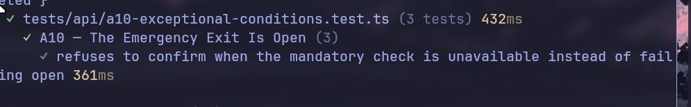

# A10 - The Emergency Exit Is Open

## Vulnerability

`POST /api/bookings/:id/confirm` is supposed to confirm a booking only once a readiness check passes: the booking must be `pending` and its payment `approved`. That check runs inside a `try` block, and if it throws for any reason — including the local readiness checker simply being unavailable — the `catch` treated the failure as a *pass*. An unavailable mandatory security control therefore confirmed the booking anyway, with no payment verification at all: a fail-open design (CWE-636, not failing securely) instead of fail-closed.

## Exploitation

- Log in as Alice: `POST /api/auth/login` with her demo credentials, which returns a bearer `token`.
- Call `POST /api/bookings/40000000-0000-4000-8000-000000000001/confirm` with `Authorization: Bearer <token>` and body `{"simulateCheckFailure": true}`, which forces the readiness check to throw.
- The response is `200 OK` with `{"status":"confirmed","flag":"FLAG{a10_...}"}` — the booking is confirmed and the flag leaks, even though the mandatory check never actually ran.

## Root Cause

In `apps/api/src/routes/bookings.ts`, the `confirm` handler's `catch` block set `checksPassed = true` whenever the readiness check threw:

```ts
try {
  if (simulateFailure) throw new Error('Local readiness checker unavailable');
  checksPassed = result.rows[0].status === 'pending' && result.rows[0].payment_status === 'approved';
} catch {
  checksPassed = true; // fail open
}
```

Any exception from the check — a simulated outage here, but equally a real database or dependency failure in production — bypassed the business rule entirely instead of blocking the state transition.

## Remediation

- `apps/api/src/routes/bookings.ts`: the `catch` block now sets `checksPassed = false`, so an unavailable or failing readiness check blocks confirmation (`409`) instead of approving it. The booking only moves to `confirmed` when the check genuinely ran and passed.
- The characterization test in `tests/api/a10-exceptional-conditions.test.ts` was converted into a regression test: a simulated check failure now asserts `409` and no flag in the body. A new business test was added to cover the previously-missing positive path — a genuine readiness-check pass still confirms the booking (`200`) — alongside the existing test that preserves the normal rejection when payment is missing.

## Verification


